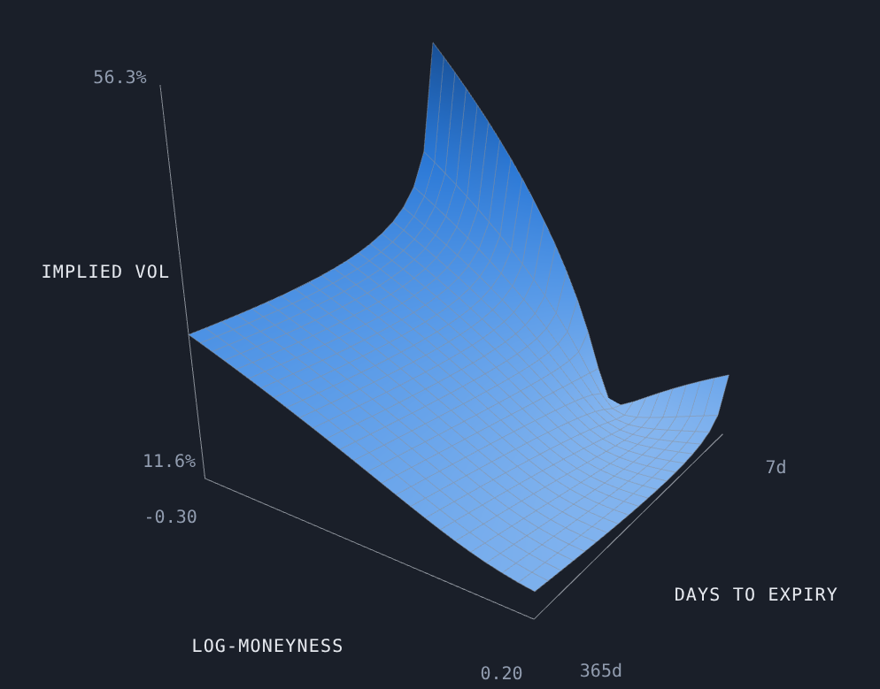
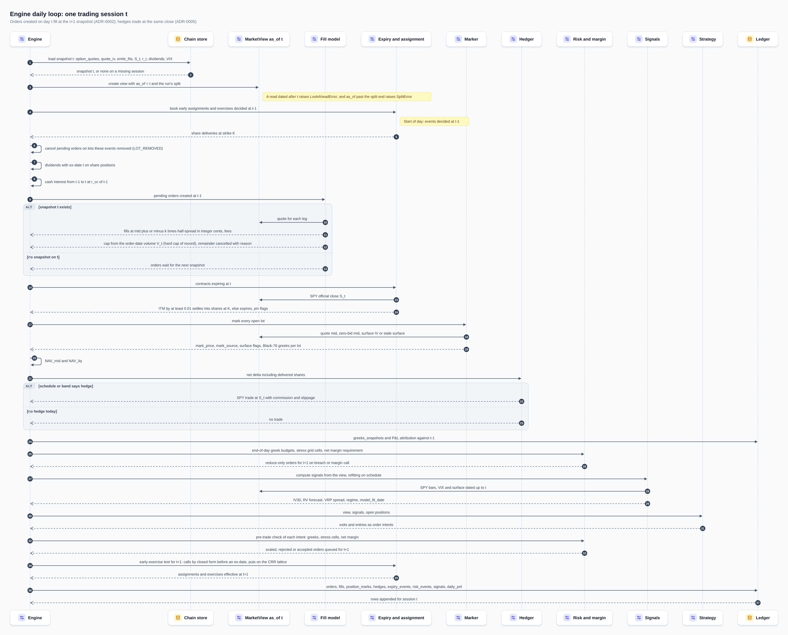

# Vol Strategy Backtester

Backtests option strategies that try to harvest SPY volatility mispricing: straddles, strangles,
calendar spreads and a volatility-risk-premium signal (implied vol vs a forecast of realised vol).
The design goal is to show how much of the premium survives:
- fills at bid/ask, with a cap on contracts per option per day;
- greek and stress-loss budgets;
- an honest capital base with real margin calls;
- the 2018–2025 volatility shocks.

> **Educational project — not financial advice.** It places no orders and makes no claim that any
> strategy is profitable.

**Status: milestone 0 (foundations).** The repo has the scaffold, design and decision records. No
strategy results exist yet. The results table below fills in at milestone 6, and every number in it
will be regenerated by the pipeline and independently re-measured.



*The app's 3D hero at milestone 0: an **illustrative** SSVI surface, not market data, exported by
`tools/export_app_data.py` and drawn by the React app. Real SPY surfaces replace it at milestone 2.*

## Results

*None yet.* Milestones 1–6 build the data layer, pricing core, engine, strategies, risk and
reporting (see [LEARNING_LOG.md](LEARNING_LOG.md)).

## Design

- **The engine's day**, in the fixed order of ADR-0001:
  
- **Architecture**, data flow, process and data model: [`docs/architecture/`](docs/architecture/)
  (Mermaid sources render on GitHub; SVG/PNG/draw.io copies in `out/`).
- **Decisions:** [`docs/adr/`](docs/adr/), ten ADRs, each with the alternatives it rejected and what
  the milestone-0 adversarial review changed.
- **Validation:** [`docs/validation/`](docs/validation/), the evidence-gated review ledgers.
- **App screenshots:** [About, dark](docs/images/app/about-dark.png) ·
  [About, light](docs/images/app/about-light.png) ·
  [Architecture page](docs/images/app/architecture-light.png).
- **Knowledge graph:** [`docs/architecture/graph/`](docs/architecture/graph/) (graphify).

## Run

Python 3.12 via [uv](https://docs.astral.sh/uv/); Node 22 for the app.

```bash
uv sync                                         # exact pins from uv.lock
uv run pytest -q                                # tests
uv run python tools/build_notebooks.py --check  # notebooks in sync with src/
uv run python tools/export_app_data.py          # write app/public/data/*.json
```

```bash
cd app
npm ci
npm run dev      # local app
npm run verify   # lint + tests with coverage thresholds + production build
```

```bash
uv run --group diagrams python tools/diagrams/build.py docs/architecture/specs --out docs/architecture/out   # specs -> out/
npm ci --prefix tools/screenshots                # then, from tools/screenshots: npm run capture
```

## Data

Raw vendor data is **never committed**. Loaders read it from `VOL_DATA_DIR`, which defaults to
`~/data/vol-projects`.

| Use | Source | Licence / terms |
|---|---|---|
| SPY option chains 2010–2023 | OptionsDX SPY end-of-day, re-hosted on Kaggle as `dudesurfin/spy-options-eod-volatility-surface-2010-2023` | Vendor data: not redistributed here |
| SPY option chains 2024–2026 (out-of-sample) | DoltHub [`post-no-preference/options`](https://www.dolthub.com/repositories/post-no-preference/options) | CC BY-SA 4.0 |
| SPY prices and dividends | yfinance | Yahoo terms: not redistributed |
| Risk-free rate | FRED `DGS3MO` | Public |
| VIX history (regimes) | CBOE | Personal, non-commercial use: not redistributed |

## Data and licences

The data is not covered by this repository's MIT licence. [DATA.md](DATA.md) lists each source with its terms and a link, and says what is committed (small derived tables, the app JSON, real values in docs) and what never is (the downloaded vendor files). Tables derived from DoltHub carry a CC BY-SA 4.0 notice next to them, for the app data in [app/public/data/LICENSE-DATA.md](app/public/data/LICENSE-DATA.md). `tools/licensing/check_tracked_data.py` fails the build of a commit that would take a raw vendor file or a data file over 50 MB.

## Layout

```
src/volbt/        all logic (data, pricing, signals, strategies, risk, engine, analytics, export)
tests/            pytest; hand-worked expected values, mutation-checked
notebooks/        generated from src/ by tools/build_notebooks.py (a test keeps them in sync)
tools/            notebook builder, app-data exporter, blender/ render scripts
app/              Vite + React 19 + TypeScript + three.js; only renders app/public/data/*.json
docs/prfaq.md     Amazon-style PR/FAQ, written working backwards
docs/adr/         architecture decision records
docs/architecture/ diagram specs (YAML) and Mermaid diagrams
docs/concepts/    theory notes with the maths
docs/milestones/  per-milestone walkthroughs and interview questions
docs/validation/  adversarial-review ledgers
```

## Licence

MIT, see [LICENSE](LICENSE). Data licences are listed above and apply to the data, not to this code.
